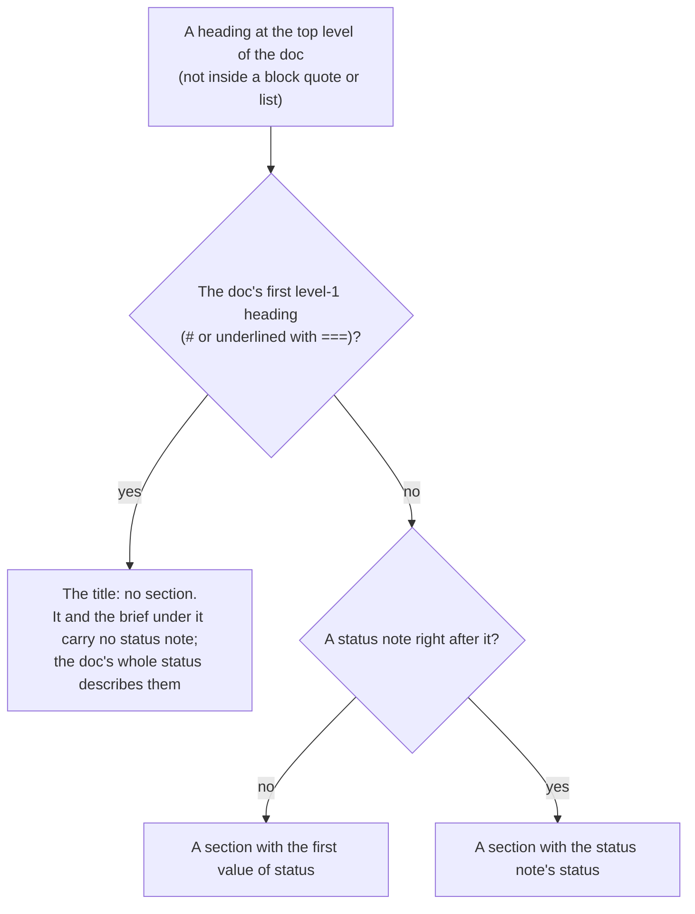
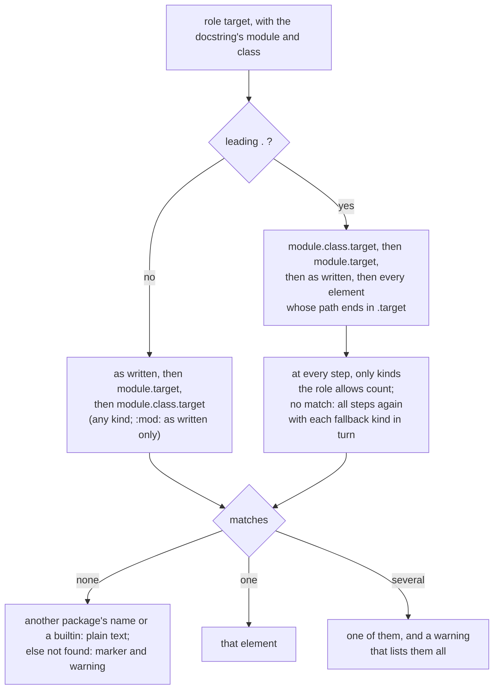

# How docspecsite works

**docspecsite** is a Python package that implements the [docs system requirements](../behavior/requirements.md).
Those requirements are numbered `DSR-1`, `DSR-2`, … (DSR = "docs system requirement"), and this page cites them by number, e.g. "(DSR-3)" means "this satisfies requirement DSR-3 in that doc".
It reads a repo's `docs/` and their history, through a versioning backend ([versioning-backends.md](versioning-backends.md)), and writes a static site to `site/` (gitignored).
Its commands are `check`, `list`, `backlinks` and `build` ([behavior/commands/](../behavior/commands/index.md)).
Its own code holds the doc model, the history, the checks and the version-aware links; the site's pages are rendered by a **site renderer**, by default Sphinx, chosen in [DSS-0008](decisions/DSS-0008-sphinx-site-renderer.md) (an [architecture decision record](../meta/glossary.md#adr)), which supersedes the custom renderer of [DSS-0001](decisions/DSS-0001-custom-per-doc-history-renderer.md).
That custom renderer stays selectable as the `internal` renderer until a later release removes it; the build front, the renderer seam and the `sphinx` renderer are in [site.md](site.md).
Where this page describes rendering (output layout, page anatomy, the code reference's pages, incremental builds), it describes the `internal` renderer unless it says otherwise.

## Repository layout

| Path | Holds |
| -- | -- |
| `src/docspecsite/` | The package: one module per concern (see [Modules](#modules)), the `internal` renderer's Jinja templates in `templates/` and its CSS and JS in `static/`; the `sphinx` renderer's extension, templates and static files in `sphinx/` ([site.md](site.md#the-sphinx-renderer)). |
| `scripts/` | Scripts for working on docspecsite itself, such as `compare_renderers.py`, which builds both renderers' sites of one repo state and compares them ([site.md](site.md#operational-notes)). |
| `tests/` | The pytest suite ([DSS-0004](decisions/DSS-0004-pytest-for-tests.md)); fixtures build throwaway docs trees and git repos. |
| `pyproject.toml`, `uv.lock`, `.python-version` | The one uv project and its Python pin ([DSS-0002](decisions/DSS-0002-single-python-toolchain.md)); also the Ruff, Pyrefly and pytest settings. |
| `Dockerfile` | The image other repos build for listing, building and serving, and the dev image ([Docker image](#docker-image)). |
| `compose.yaml`, `docker/docs-serve/` | Services for working on docspecsite itself ([dev-environment.md](dev-environment.md)). |
| `.pre-commit-hooks.yaml` | The `docs-check` hook other repos use ([prek hook](#prek-hook)). |
| `docspecsite.toml` | The settings for docspecsite's own docs ([behavior/configuration.md](../behavior/configuration.md)). |

## Dependencies

- Python: the version pinned in `.python-version`, installed by uv ([DSS-0002](decisions/DSS-0002-single-python-toolchain.md)).
- `markdown-it-py` + `mdit-py-plugins` (front matter, heading anchors, tables) — the Markdown parser behind `check`'s links, headings and status notes, and the `internal` renderer's Markdown → HTML ([DSR-3](../behavior/docs-format.md#requirements)); MyST-Parser builds on the same two, and its heading anchors use mdit-py-plugins' `slugify`, so `check` and the site agree on anchors.
- `pyyaml` — front matter.
- `jinja2` — the `internal` renderer's page templates (auto-escaping, loops and template inheritance without hand-written templating); Sphinx and furo use it too.
- `sphinx` — the `sphinx` renderer's engine: pages, cross-references, Sphinx's Python roles in docstrings resolved by its Python domain ([DSR-34](../behavior/code-reference.md#requirements)), full-text search ([site.md](site.md#the-sphinx-renderer)) ([DSS-0008](decisions/DSS-0008-sphinx-site-renderer.md)); it brings docutils and its own small dependencies.
- `myst-parser` — Markdown docs as Sphinx sources, with MyST's extra syntax switched off so docs stay plain CommonMark ([DSR-3](../behavior/docs-format.md#requirements)).
- `sphinx-autoapi`, with `astroid` pinned — the code reference's pages from the code without importing it ([DSR-18](../behavior/code-reference.md#requirements)).
- `furo` — the `sphinx` renderer's theme: a sidebar with the doc tree and the page's Contents, a search box, light and dark modes; the page chrome is built on its template blocks.
- **Mermaid** — renders `mermaid` code blocks as diagrams in the browser; its bundle is downloaded at a pinned version with a sha256 check when the image is built, kept in the image outside `/repo`, and copied by docspecsite into `site/assets/` (the `internal` renderer) or `site/_static/` (the `sphinx` renderer), so the site works offline.
  The directory holding it is named by `DOCSPECSITE_VENDOR_DIR`; without it, diagrams are shown as source.
  A static asset, not a Python dependency.
- `griffe` (the library-only `griffelib` distribution) — the code that `check --optional-checks code` looks up ([DSR-36](../behavior/commands/check.md#requirements)) and the `internal` renderer's code reference pages ([DSR-18](../behavior/code-reference.md#requirements)).
- stdlib `tomllib` for `docspecsite.toml`, `difflib` for diffs, `importlib.metadata` entry points for finding versioning backends, `subprocess` + the `git` CLI for the git backend ([DSS-0007](decisions/DSS-0007-git-command-line.md)).
  Every runtime dependency is listed here with its reason, and a new one needs an ADR ([DSR-23](../behavior/distribution.md#requirements)).
  The Sphinx packages are always installed, also where only `check` runs (the prek hook's environment), although `check`, `list` and `backlinks` never import them ([DSS-0008](decisions/DSS-0008-sphinx-site-renderer.md)).
- Development only: pytest, Ruff and Pyrefly ([quality-gate.md](quality-gate.md)).

## Modules

The package has one module per concern: the config file, the checks, the query commands, the versioning backends (with git and `none`), the history core works on, the site build and the code reference.
State that several functions share lives on classes instead of being passed from function to function: the project's settings (`ProjectConfig`, read by a `ProjectConfigParser`), the loaded docs with their backlinks (`DocSet`), one check run (`Checker`), front-matter validation (`FrontMatterValidator`, with a `FrontMatterCheck` per doc), the project's code (`Codebase`) and its reference pages (`CodeReference`, with a `CodePage` per module), the index pages (`IndexRenderer`), the docs' version-aware links (`Resolver`, with the `PageLinks` of one page) and the site build (`SiteBuilder`, writing to the output directory through a `SiteWriter`).
Each function then takes only what it uses itself, and the state each part works on is in one place.
The generated [code reference](../reference/code/index.md) lists every module and class with its documentation.

### Site renderers

> **Not built yet.**

The build is split at a renderer seam ([site.md](site.md#the-renderer-seam)).
The build front is `SiteBuilder` in `docspecsite.build`, writing through `SiteWriter`; its duties are in [site.md](site.md#build-front).
`docspecsite.renderers` holds the renderer name type `RendererName`, the `SiteRenderer` interface, the prepared input (`PreparedSite`, with the build's docs in `SiteDocs`) and `RenderedSite`; what it and each renderer may import is in [site.md](site.md#the-renderer-seam).
The index entries, their grouping and the `llms.txt` text are `SiteIndex` in `docspecsite.indexes`; the cache roots and the front's cache of front matter splits are in `docspecsite.diskcache`.
The `internal` renderer is `InternalRenderer` in `docspecsite.internal_renderer`, with the modules only it uses (`pages`, `cache`, the index pages' HTML part `index_pages`, its templates and static files); the `sphinx` renderer with its Sphinx extension is the `docspecsite.sphinx` package.

## Configuration

Settings come only from `docspecsite.toml` at the root of the checked repo ([DSR-32](../behavior/configuration.md#requirements), keys in [behavior/configuration.md](../behavior/configuration.md)).
Every command reads the working-tree file from disk, never through the version control: reading the settings stays a light step that needs no history, the versioning backend is chosen from it before any history is read ([versioning-backends.md](versioning-backends.md#start-of-every-command)), and an old ref is built with today's settings.
The settings say where the repo's code is (`code-dirs`), so docspecsite does not depend on how a project lays out or builds its code.
One matcher in `ProjectConfig` decides which directories are code directories, both for the working tree and for the files of a ref, so `check` and `build` find the same packages; `.` (the repo root) makes `build` extract the whole tree.
Unknown settings and invalid values are reported, never silently ignored.
`ProjectConfig` is the one owner of whether an id in the `code-components` setting is known: its check takes the component vocabulary and returns the known components of each key together with the unknown entries. `check` reports the unknown entries on `docspecsite.toml`, `SiteBuilder` warns about them when it builds the `code` part, and `ProjectConfig`'s lookup of a module's components reads only the checked mapping, so no code page gets an unknown component (the problem: [behavior/configuration.md](../behavior/configuration.md#settings); the warning: [behavior/commands/build.md](../behavior/commands/build.md#what-the-build-does)).

## ADR IDs

> **Built.**

An ADR's file name carries its ID: `architecture/decisions/<PREFIX>-NNNN-<slug>.md` ([meta/structure.md](../meta/structure.md#adr-ids)).
`check` accepts the repo's own `adr-prefix` and the prefixes in `external-adr-prefixes`, and reports any other name under `architecture/decisions/` ([DSR-33](../behavior/docs-format.md#requirements)).
Each prefix's numbers are zero-padded, so sorting by path orders each prefix's ADRs by number; generated listings additionally put external ADRs first, in the order of `external-adr-prefixes`.
The hand-written `architecture/decisions/index.md` lists ADRs grouped by prefix, external prefixes first.

## History model

Core works on the version history the selected backend returns ([versioning-backends.md](versioning-backends.md#contract)); with the `none` backend each doc has one version from disk and no `/v/` pages.
The git backend, with `versions = "commits"` (the default), builds it as follows; `versions = "tags"` selects from the same lists ([versioning-backends.md](versioning-backends.md#git-backend)).

- Ordered version list: `git rev-list --first-parent <ref>` (linear, newest first).
- Versions of a doc: commits from that list that touch its path (`git log --first-parent --format=%H%x00%cI%x00%s <ref> -- <path>`) ([DSR-4](../behavior/versioning-backends.md#versions-of-a-doc), [DSR-5](../behavior/versioning-backends.md#versions-of-a-doc)).
- Content of a version: `git show <commit>:<path>`, decoded as UTF-8 with a leading byte order mark dropped, as `check` reads the working tree.
- Paths in git's output are kept as their bytes, so a name that is not valid UTF-8 still maps back to its file ([behavior/commands/](../behavior/commands/index.md#input-that-cannot-be-used)).
- git runs at the top level of the checked repo, and its `log` output is read with `--no-show-signature`, so a user's `log.showSignature` cannot put gpg output into it.
- Version-aware link resolution ([DSR-11](../behavior/site.md#rendering)), in core and for every backend: in doc A's version X, a link to B resolves to B's newest version whose position in the backend's linear order is at or after X's position (i.e. not newer than X); with git commits mode the position is the commit's place in the first-parent list.
  If B has none, link to B's latest and add a "newer doc" marker.
  A body link to a target that is not found is text with the "not found" marker, whatever kind of file it names (one marker, since the build cannot tell a deleted doc from a typo or a missing image); `related` and `redirect_to` entries and `Docs:` lines in code do not use this marker.
  [behavior/commands/build.md](../behavior/commands/build.md#what-the-build-does) defines which targets are found.
  `SiteBuilder` puts the found repo file paths together and gives them to the `Resolver` (`docspecsite.urls`): the files of the built revision's tree and, with `--include-worktree`, the non-Markdown files under `docs/` that git sees in the working tree, both read by `Git`.
  The paths of the symlinks that lead to a doc, and of the symlinks and other files left out of the site are not among them; the files that a followed symlinked directory gives are, at their paths below the symlink ([Output layout](#output-layout)).
  The marker is shown in every version; the warning is given only for the latest version of the linking doc.
- Uncommitted working-tree changes are rendered as an extra "working copy (uncommitted)" version only when `--include-worktree` is given (useful while writing; never in CI).
  A working-tree file counts as changed when git hashes it, with its line-ending conversion and clean filters applied, to a blob other than the one in the ref's tree.
  The `build` command in `docspecsite.cli` decides which revision is built when `--ref` is not given: `HEAD`, the checked-out commit, with or without `--include-worktree` ([behavior/commands/build.md](../behavior/commands/build.md#what-the-build-does)); `History` and `SiteBuilder` always get a ref.
- A symlink is never a doc, whatever it leads to ([DSR-39](../behavior/doc-symlinks.md#on-the-site)), and `History` never returns one.
  `Git` says of each path whether it is a symlink where it is read: in the built revision's tree (by the tree entry's mode, `120000`), in each change of the history and in the working tree.
  From that, `History` leaves out a version in which the path is a symlink; a path that is a symlink at the built revision is no doc of the site, with no pages in any version; a path that is a regular file at the built revision keeps the versions in which it was one.
  With `--include-worktree`, a path that is a symlink at the built revision but a regular doc in the working tree is a new uncommitted doc: it gets a working-copy version, its only version.
  A path that is a regular doc at the built revision but a symlink in the working tree has no working-copy version, and its committed versions keep their pages.
- One "is a doc" rule in `docspecsite.docs` says what a doc is: a `.md` path under `docs/`, outside the doc templates, that is a regular file with no symlinked directory between it and `docs/`.
  Every part that decides whether a path is a doc asks that one rule, and gives it what it knows about the path (the file on disk, or an entry of a tree):
  - `History`, for the docs of the built revision, of each change and of the working tree;
  - `DocSet`, for the docs that `check`, `list` and `backlinks` read;
  - the check's link check (`LinkCheck`), for whether a link's target is a doc, and its index check, for the children an index lists;
  - `SiteBuilder`'s copying of the docs files and the `Resolver`'s found files, where a file under `docs/` that is not a doc or a doc template is a file to copy;
  - the path lookup of the `backlinks` command, in `docspecsite.query`.
- That lookup takes the path as written, relative to `docs/`, and follows no link below the repository root: `..` is worked out on the path's text, and a path that leaves `docs/` that way is no doc.
  An absolute path may reach the root itself through symlinks (a shell's working directory below a symlinked parent directory): its shortest ancestor that is the root stands for it.
  A `docs/` directory that is itself a symlink is outside this design.
- One rule says what a symlink under `docs/` leads to, for `check` (whether the symlink is a problem, and its hint) and for the docs files `SiteBuilder` copies; [behavior/doc-symlinks.md](../behavior/doc-symlinks.md#how-a-symlink-is-followed) defines it and shows it as a diagram.
  The rule gives one of five kinds (out of the repo, nothing, a doc, a directory, another file) from the end of the symlink's chain alone, never from the symlink's own name.
  A chain of symlinks is followed while every step stays inside the repo: a target that is absolute or outside the repo gives "out of the repo", and one that does not exist, or a path already passed on the way from `docs/`, gives "nothing", so no loop of symlinks makes the check or the build run forever ([DSR-39](../behavior/doc-symlinks.md#symlink-loops)).
  The symlinks inside a directory that a symlink leads to are followed by the same rule, with the paths already passed carried along; from them and the `.md` files there, the rule also says whether the directory has a doc inside.
  The target is looked up where the part reads its other files: on disk for `check`, and for `SiteBuilder` where it copies the docs files from ([Output layout](#output-layout)).
- `check` reports each symlink that leads out of the repo, to nothing, to a doc or to a directory with a doc inside once, with its target read from the link, and skips the symlinks inside `docs/meta/templates/`, as it skips templates in every check.
  It never reads outside the repo, and takes its kinds and the hint from the rule for following a symlink (the bullet above).
  A reported directory is one problem; inside a directory that is not reported, a symlink that leads out of the repo or to nothing is reported at its path below the directory's symlink.
  The index check takes no symlink as a directory that needs an `index.md` or as a child to list, and the link check gives a link to a symlink that leads to a doc, to a reported directory or to a `.md` file inside a symlinked directory its own message ([behavior/commands/check.md](../behavior/commands/check.md#what-the-check-reports)).
  The staged check in `Checker` passes over a path that is a symlink in the tree of `HEAD`.
- The rules on symlinks, found targets, the default revision and changed code files ([Code reference](#code-reference)) are stated here for the parts that hold them today.
  The backend contract keeps the same rules in its rows, for the git parts of `History` and `Git` as the git backend ([versioning-backends.md](versioning-backends.md#contract)).

## Statuses and status notes

> **Built.**

A doc's `status` is one value or, for a partly built doc, a list ([behavior/status-notes.md](../behavior/status-notes.md), DSR-44 to DSR-49); in a [layer without a build status](../meta/lifecycle.md#layers-without-a-build-status), today the scenarios layer, docspecsite ignores the build statuses, the `milestone` and `priority` fields and status notes ([DSR-53](../behavior/docs-format.md#layers-without-a-build-status)).
The status is parsed once into one type that every reader uses; the section notes are read from the Markdown parser's block structure; and the checks compare them with the rules: the front-matter check, the status note check, the check of a scenario doc's `related` list, and the title check that keeps each doc's title in its place (DSR-52).



- **Vocabulary.** `docspecsite.docs` holds the closed vocabularies as enums: the statuses (`Status`, in the status board's order, with the build statuses as a named subset), the layers (`Layer`), the priorities (`Priority`, also the status board's order) and the roadmap fields (`RoadmapField`); `docspecsite.schema` builds on it and holds the default status note texts by status and the one rule for a valid `status` front-matter field.
  The project's `status-notes` setting, held by `ProjectConfig`, replaces default texts.
- **Layers without a build status.** `docspecsite.docs` holds the one table of them, keyed by `Layer`, next to the values a status list may hold, since `DocStatus` needs both and `docspecsite.schema` already builds on `docspecsite.docs`: each such layer, mapped to the layers whose docs its docs must name in `related` (today `scenarios` → `behavior`, `ui`).
  `DocStatus` and the related check read the table, never a layer name, so another such layer is one more entry, added once the method's `docs/meta/` names it.
  It is a method rule, not a setting in `docspecsite.toml` ([guiding principles](index.md#guiding-principles)).
  A doc's layer for these rules is the one of its directory, so a wrong `layer` field gives its own problem and does not change which rules apply.
- **Parsed status.** `docspecsite.docs.DocStatus` is the parsed `status` with the `milestone` and `priority` fields, built once per doc from its front matter and its path (by `Doc`, and once per version for the site's pages), and every reader of them goes through it instead of reading the front matter: the front-matter check, the `list` filters and output, `llms.txt`, index entries, the status board and the page badges (parse, don't validate).
  This is the one place where the ignoring of [DSR-53](../behavior/docs-format.md#layers-without-a-build-status) happens: for a doc in a layer of that table, `DocStatus` leaves out the build statuses, the milestone and the priority, so every reader sees the doc as if they were not written, in every version.
  It keeps the build statuses it left out apart from its values, for the warning only.
  A single value and a one-value list give the same `DocStatus`; its values stay in the doc's order with duplicates kept, so the check can report them.
  It formats itself for listings, for JSON and for hints.
  A `status` of the wrong shape gives no values, so the doc is left off the status board like one with an unknown status; a doc with no values matches no `list --status`, has an empty text column and `null` in JSON, no `status:` part in `llms.txt` and no badge.
- **Front-matter check.** `FrontMatterCheck` reports an invalid `status` (DSR-44), and a single-only value in a list and a value listed twice, with hints (DSR-46), and checks the milestone and the priority, all from the doc's `DocStatus`.
  For a doc in a layer of that table, `status` is not a required field, and a `status` whose values were all left out counts as not written; any other `status` is checked by the same rules as in every doc.
  It gives the [DSR-53](../behavior/docs-format.md#layers-without-a-build-status) warning when the left-out values hold `implemented`, as a `Problem` marked as a warning; `check` prints the warnings after the problems and, with `--strict`, exits with 1 when there is any, with the counts unchanged ([behavior/commands/check.md](../behavior/commands/check.md#what-the-check-reports)).
- **Title and sections.** `docspecsite.markdown.MarkdownText` is the one place that decides which heading is the doc's title: the first level-1 heading at the top level, in either style.
  The title check and the section notes both take the title from it, so they never disagree.
  Every other top-level heading opens a section, and sections form no tree: a section's status is its own status note's, else the first value, and nothing is compared between a heading and the headings above or below it.
- **Section notes.** `MarkdownText` reads each note line with a bold label from the block quotes right after a heading and gives it as a `SectionNote`: its label, its heading as written in the file (`#` marks included, so problems quote it as it is), whether that heading is the title, and its line.
  It reads the tokens of markdown-it, which docspecsite already uses for links and headings, so code blocks and notes after other content are left out without rules of their own (DSR-45).
  It does not filter labels.
- **Note kinds.** `docspecsite.check` keeps a registry of note kinds in `StatusNoteCheck`, from label to kind; `StatusNote` (a label and its status) is the only kind, and a later kind (such as a warning) is a new entry.
  A label that is not in the registry stays ordinary text (DSR-45), and nothing relies on the order of the notes in a block.
- **Status note check.** `StatusNoteCheck`, a `DocCheck`, compares a doc's `DocStatus` with its status notes (DSR-46).
  One mistake gives one problem: it skips a doc whose `status` the front-matter check rejects, a status note under the title gives only the title problem, and a second status note in a section gives only its own problem while its status still counts as given.
  Its hints are built from the `DocStatus` with a value added or removed, and offer adding a value only when the result is a valid `status`.
  It skips a doc whose layer has no build status, so its status notes stay ordinary text (DSR-53).
- **Related check.** `RelatedOwnersCheck`, a `DocCheck` in `docspecsite.check` built by `Checker` with the loaded `DocSet`, reports a doc in a layer of that table whose `DocStatus` has no values or is `draft`, and whose `related` front-matter field names no doc of the mapped layers whose `DocStatus` is neither `deprecated` nor `redirect` (DSR-53).
  It reads the other docs' statuses from the `DocSet`, so it needs no second read of any file; an entry that is not a doc of the `DocSet` does not count, and the link check reports it.
  It reads the entries as `DocLinks` reads every front-matter link (anchor removed, path normalized), so an entry names the same doc for it as for the link check.
  It skips an `index.md`, a `deprecated` or `redirect` doc, a doc whose `status` the front-matter check rejects, a missing `related`, which is already the missing-field problem, and a `related` that is not a list of strings, which is already the front-matter check's `"related" must be a list of strings` problem; its hint offers `status: deprecated` when one of the named docs of the mapped layers is `deprecated`.
- **Title check.** `TitleCheck`, a `DocCheck` in `docspecsite.check`, reports a doc whose text does not start with its title and each level-1 heading after the title (DSR-52); it skips a doc whose front matter is missing or does not load.
  It compares lines, not blocks, since markdown-it leaves link reference definitions out of its blocks: any line that is not blank before the title's line is text before the title.
  Its hints quote the heading as written and, for a doc without a title, offer the front matter's `title`.
- **Rendering** does not touch status notes: they are ordinary block quotes in the body.
  A page shows one status badge per value, index entries one per value, and the status board places an entry under each of its values (DSR-48, DSR-49).

## Output layout

The `internal` renderer's layout; the `sphinx` renderer keeps every path except the code pages and `assets/`, whose files go to `_static/`, and adds search and a general index ([site.md](site.md#output-layout-of-the-sphinx-renderer)).

```
site/
  index.html                       rendered docs/index.md
  <path>.html                      latest version of docs/<path>.md
  <path>/v/<short-id>.html         each version (latest included, for permalinks); not for a versionless backend
  <path>/v/<short-id>.diff.html    diff vs previous version (DSR-10)
  reference/code/<dotted.path>.html   code reference pages (latest code only, no /v/ versions)
  tags/<tag>.html  components/<c>.html  status.html     indexes (DSR-15)
  llms.txt                         machine listing (DSR-16)
  assets/                          one CSS file, minimal JS for the version picker, the Mermaid bundle
```

Some doc paths are **reserved**, because their page would take the URL of a generated page of either renderer: `status.md`, every doc under `tags/` and `components/`, every doc under `reference/code/` other than the entry page `reference/code/index.md`, and every doc under `<path>/v/` when `<path>.md` is a doc (where that doc's version and diff pages go); for the `sphinx` renderer also `search.md`, `genindex.md` and every doc under `_static/`.
One list in `docspecsite.urls` holds them, with the renderer each path belongs to: the build front applies the paths of the renderer in use, and `check` applies those of both, whatever the `renderer` setting, so switching renderers never turns a passing check into a failing build.
`check` reports a doc at a reserved path ([DSR-20](../behavior/commands/check.md#requirements)); the build keeps the generated page and reports the doc's page as an error.

`SiteBuilder` copies the non-Markdown files under `docs/` (images and the like; doc templates are left out) into the site at their own path: from the tree of the built revision, or with `--include-worktree` from the working tree, where only the files git sees count.
A symlink there counts by what it leads to, whatever its name, which the builder finds by the rule for following a symlink ([History model](#history-model)).
One that leads to another file arrives as that file, never as its link text, and one that leads to a directory as the non-Markdown files inside it, at their paths below the symlink, with the symlinks inside followed by the same rule ([DSR-39](../behavior/doc-symlinks.md#other-files-under-docs)).
A symlink that leads to a doc is left out without a word, since `check` reports it; one that leads out of the repo or to nothing is left out with a warning ([behavior/commands/build.md](../behavior/commands/build.md#what-the-build-does)).
The paths copied this way are the docs files the `Resolver` takes as found ([History model](#history-model)).
With the `sphinx` renderer, a copied file whose path a generated file takes is left out with a warning ([site.md](site.md#output-layout-of-the-sphinx-renderer)).

`site/.docspecsite-manifest` lists the files of the last build, so the next build removes only files it wrote itself.

### Parts

The site is built in parts ([DSR-35](../behavior/site.md#rendering)): `docs` is everything above except `reference/code/`, and `code` is `reference/code/` (module pages and the entry page `reference/code/index.html`).
The build carries the set of parts it builds, and every link that crosses parts asks whether its target's part is in that set: the docs' resolver for `code:` links and the index entries of code modules (`llms.txt` lists docs only, [DSR-16](../behavior/site.md#navigation-and-indexes)), the code pages for `Docs:` lines, "described in" lists, links to docs and the page chrome (breadcrumb, components, status badge).
A link into a part that is not built becomes text, or, from the code reference to a doc, a link to the doc's Markdown file through the backend's `file-link` pattern (with git by default `<source-url>/blob/<commit>/docs/…`).
A link to another file of a part that is not built (such as an image) is linked on the repository host like a file outside `docs/`, with no warning of its own; without a `source-url` it is plain text, and the one warning about the missing `source-url` applies as for any repo link ([behavior/commands/build.md](../behavior/commands/build.md#what-the-build-does)).
A code-only build also writes the entry page as `index.html`, with its links relative to the root.
Since the entry page has no old versions, a link to it from an old version of a doc leads to its latest page with the "current code" marker, like an old version's `code:` link.
A build never reuses pages of an earlier build with other parts: a page's links depend on the parts, and the manifest leaves `--out` holding only what this build wrote.

## Page anatomy

Every page: breadcrumb, title, status badges (one per status, [statuses](#statuses-and-status-notes)), components and tags (linked to indexes), version picker, body, related + backlinks panel; code pages also list their submodules (doc index pages list their children in their own `## Children` section) ([DSR-8](../behavior/site.md#rendering), [DSR-14](../behavior/site.md#navigation-and-indexes)).

With the `sphinx` renderer, the same elements sit on furo's layout: a sidebar with the doc tree, the search box and the page's Contents, ¶ links on the headings, and the version picker as a collapsible list ([site.md](site.md#the-sphinx-renderer)).
A body link to a heading uses docutils' section id (`#don-t`) where it differs from the slug that `check` validates (`#dont`); the heading carries both ids, so both forms lead to it.
A heading made only of punctuation has only docutils' numbered id (such as `#id1`), and no link can name it: its slug is empty, so `check` knows no anchor for it and reports a link to any anchor meant for it as a missing heading.

**Contents** (the `internal` renderer only; the `sphinx` renderer's sidebar shows the page's Contents instead): a doc with at least `toc-min-headings` `##` sections gets a generated "Contents" list of its `##` headings, each with its `###` headings nested, inserted in the body right before the first `##` section, so after the summary paragraph when there is one ([meta/authoring.md](../meta/authoring.md#page-shape)).
It links to the same heading anchors that `docspecsite check` validates, and every version of the doc gets it.

**Old versions** ([DSR-9](../behavior/site.md#rendering)): a full-width sticky red banner "⚠ OLD VERSION — <date>, <short-id> — this is NOT the current spec. → Latest version"; `<title>` prefixed with `[OLD]`; tinted page background.
**Redirect docs** ([DSR-12](../behavior/site.md#rendering)): no automatic redirect. A normal page with a prominent notice box ("Renamed / Moved / Merged / Split / Became a directory / Replaced by … / Removed"), links to the replacement doc(s), the reason, the doc's own body, and its version picker. Links from other docs to a redirect doc are shown with a small "→ moved" marker.

## Code reference

This section describes the code reference of the `internal` renderer and the lookup `check --optional-checks code` uses; the front reads the code at the ref the same way for both renderers.
The `sphinx` renderer's code reference (sphinx-autoapi pages at nested URLs, roles resolved by Sphinx's Python domain, source lines from autoapi's parse) is in [site.md](site.md#the-sphinx-renderer).

Python code is loaded once, from the code directories the backend gives for the built revision, with griffe: every package directly inside a `code-dirs` directory.
At a ref, the git backend lists the code directories' files with `git ls-tree -r` and reads their blobs with the same `cat-file --batch` reader in `Git` that reads the doc versions, not with `git archive`: code at a ref is the committed bytes, as for doc versions, with no checkout filters, line-ending conversion or export attributes (`export-ignore`, `export-subst`). A code directory that is itself a symlink is resolved within the built revision's tree, and its target directory's files are read as that code directory, for the code-directory matcher in `ProjectConfig` and the search for code directories in `SiteBuilder` too; one whose target is absolute, outside the repo or missing is left out with a warning, as a symlinked image under `docs/` is, and so is one whose target is a file. The rule "out of the code directories" applies only to the symlinks below a code directory: such a symlink to an absolute path or out of the code directories is left out with a warning.
A source link's path is the file's path in the repo: for a path in `code-dirs` that is a symlink, the path of the directory it leads to.
Only the **latest** code gets pages ([DSR-18](../behavior/code-reference.md#requirements)): no version picker, no `/v/` pages; older code is read with git or an IDE.
The hand-written entry page `docs/reference/code/index.md` follows the code: it is built from its latest version only, also in a full build ([DSR-7](../behavior/site.md#rendering)).
Each module gets one page, built from the code's structure as well as its docstrings, in the spirit of Sphinx's autodoc:

- the module docstring, then its classes, functions, constants and type aliases;
- for each class: base classes (linked), the class docstring, then **members** — methods, properties, attributes and class variables — each with full **signature, type annotations and defaults**, decorators (e.g. `@property`, `@classmethod`), and its docstring; inherited members listed separately with a link to where they are defined;
- parameters, return values and raised exceptions from docstring sections (Google style), merged with the annotations;
- every type in a signature linked to its own reference entry when it is project code;
- every member with its own anchor and a link to its source at the built revision (through the backend's `file-link` pattern); with `--include-worktree`, the pages of a file that is new or changed in the working tree have no source links, since that revision does not hold the code they show: `SiteBuilder` finds those files as `History` finds changed docs (git's hash of the working-tree file against the blob in the built revision's tree) and passes them to `CodeReference`;
- member sections collapsible and a per-page member index, so large classes stay navigable.

Each page gets synthesized front matter (`layer: reference`, `components` from `code-components`) and goes through the same pipeline as other docs.
`code:<dotted.path>` links resolve to the module page plus an anchor.
Inside **old versions** of hand-written docs, `code:` links also lead to the latest code reference, marked "current code — may differ from this version"; a code element that no longer exists is shown as plain text with a "no longer exists" marker.
Sphinx-style roles in docstrings (`` :meth:`.attempt` ``) become links too ([DSR-34](../behavior/code-reference.md#requirements)).
As in Sphinx, where docutils recognizes a role while parsing and the reference is resolved later, a role is recognized by the Markdown parser, not found afterwards in its output: an inline rule of markdown-it, in the code reference's renderer only, placed before the code-span rule (as `mdit_py_plugins.myst_role` does for MyST's `` {role}`…` ``), turns `` :role:`content` `` and `` :py:role:`content` `` into a link around a code span.
The link's target keeps the role's target with its `~` and `Text <target>` form, and the code page resolves it with the docstring's object as context, passed with each render, by the rules of Sphinx 9.2's Python domain (`PythonDomain.find_obj` and `resolve_xref`, [source at v9.2.0](https://github.com/sphinx-doc/sphinx/blob/v9.2.0/sphinx/domains/python/__init__.py), checked 2026-11-24), which [DSR-34](../behavior/code-reference.md#requirements) states for readers:



- without a leading `.`: the target as is, then `<module>.<target>`, then `<module>.<class>.<target>`, whatever the element's kind; a `:mod:` target only as is;
- with a leading `.`, only an element of a kind the role allows counts, at every step (Sphinx's `object_types` table): `<module>.<class>.<target>`, then `<module>.<target>`, then the target as is, then every element whose path ends in `.<target>`;
- with a leading `.` and no match from any step, Sphinx's fallback kinds, one after the other: all the steps again with only that kind counting, for `:class:` data and then attributes, for `:attr:` methods, for `:meth:` properties;
- several matches from the last step: one of them, and a warning that lists them all; which one is not fixed and may differ between the site and the code check, so the warning is the signal;
- no match: a target that [DSR-34](../behavior/code-reference.md#requirements) counts as another package's name, a bare name in Python's `builtins` module included, stays plain text, and every other target is not found.

The codebase's index keeps each element's kind for this, and one lookup on `Codebase` in `docspecsite.coderef` serves the `internal` renderer's code pages and the code check alike.
The `sphinx` renderer leaves the lookup to Sphinx's Python domain itself, and a test builds docspecsite's own code reference with it and fails on a role the two resolve differently ([site.md](site.md#operational-notes)).
`<class>.__init__` falls back to the class when the class's `__init__` is not on the page.
In the `internal` renderer, until it is removed, the link text is set once the target is resolved: the found element's full dotted path, its last part with `~`, or the given text; the `sphinx` renderer shows the text [DSR-34](../behavior/code-reference.md#requirements) gives.
From there a role goes through the same link rewriting and markers as a `code:` link; code blocks are never touched, and a role name outside the Python ones is left as text.
`check --optional-checks code` ([DSR-36](../behavior/commands/check.md#requirements)) loads the code from the working tree and looks up each docstring's `Docs:` lines, roles and `code:` links with the same lookup as the pages, without rendering anything; plain `check` does not look at docstrings.
`Docs:` docstring lines become links, and "described in" lists come from `code:` fields ([DSR-13](../behavior/code-reference.md#requirements), [DSR-19](../behavior/code-reference.md#requirements)).
The HTTP API reference is not built yet ([behavior/web-api-reference.md](../behavior/web-api-reference.md)).

## Problems and hints

> **Built.**

`docspecsite.problems.Problem` holds a problem's location, its message and an optional hint ([DSR-51](../behavior/commands/check.md#requirements)).
It prints as the problem line, then, when it has a hint, the hint line (`  hint: <hint>`); `check --no-hints` prints the problem line only.
The message keeps one form per kind of problem, so the problem line is stable for scripts; how to fix the case goes into the hint.

## Errors and warnings

Errors in `docspecsite build` stay local to the page they occur in ([behavior/commands/build.md](../behavior/commands/build.md#what-the-build-does)).
An expected failure (a doc version that is not valid UTF-8, a doc at a reserved path) is an error line for that page.
Code that cannot be loaded is a warning instead, since it affects no single page: the code reference is built without modules, and `code:` links get the "no longer exists" marker.
Any other exception is a bug in docspecsite: it is reported as a Python warning of category `docspecsite.InternalErrorWarning`, raised while the exception is being handled, so the warning carries the original traceback.
The build's own warnings (such as unresolvable links) are Python warnings of category `docspecsite.DocspecsiteWarning`; the check's warnings are not: they are problems marked as warnings ([Statuses and status notes](#statuses-and-status-notes), [behavior/commands/check.md](../behavior/commands/check.md#what-the-check-reports)).
Both build warning categories go through Python's warning filters, so `PYTHONWARNINGS` can turn them into errors. Python reads it before docspecsite can be imported, so a filter names the built-in base category and the module that issues the warning: `PYTHONWARNINGS=error::RuntimeWarning:docspecsite.build` stops the build at the first internal error, with its traceback (useful while working on docspecsite).
With `--strict`, the build sets `error` filters for both warning categories.
With the `sphinx` renderer, Sphinx's, MyST's and docutils' warnings become `DocspecsiteWarning`s, and an exception inside Sphinx is reported as an `InternalErrorWarning` and then fails the whole build ([site.md](site.md#errors-and-warnings)).

### Closed output pipe

> **Built.**

The CLI entry point (`docspecsite.cli`) catches a closed pipe on stdout (`BrokenPipeError`), stops writing, also on the final flush, and exits with the exit code the command computed, so `list` and `backlinks` into `head` print no traceback ([behavior/commands/](../behavior/commands/index.md#output-into-a-pipe-that-closes-early)).

## Incremental builds

Only the `internal` renderer builds incrementally; the `sphinx` renderer renders the whole site afresh in a new Sphinx build directory of its own under `.docspecsite-cache/sphinx/` on every build ([DSR-24](../behavior/site.md#building), [site.md](site.md#the-sphinx-renderer)), and leaves the body cache's roots below alone.

A cache in `.docspecsite-cache/` (gitignored; inside the checked repo, so it persists between container runs) keys rendered HTML by (the version's content key from the backend — git's blob sha —, hash of the resolved link targets, docspecsite version).
Only changed versions and pages whose link targets moved are re-rendered ([DSR-24](../behavior/site.md#building)).
A diff page's body is kept by the content keys of its two versions, so an unchanged pair is not diffed again.
The build front, which loads the docs for either renderer, keeps each version's front matter split from its body (the YAML text and the line where the body starts) by its content key in a cache root of its own, so a rebuild in which every page comes from the cache runs no markdown-it on doc text; the YAML is still loaded.
The body cache has one root per docspecsite version, set of built parts and versioning backend, so builds of different parts in turn do not throw away each other's entries: a build prunes the entries it did not use only in its own root, and removes other roots only when they belong to another docspecsite version.

## Docker image

The `Dockerfile` at the repo root has two targets.
The default, `runtime` (the last stage), is the image other repos use for `list`, `build` and any other command ([DSR-22](../behavior/distribution.md#requirements)):

- base: the official uv image; uv installs Python from `.python-version` ([DSS-0002](decisions/DSS-0002-single-python-toolchain.md)), plus `git` from Debian;
- docspecsite is installed from the locked dependencies as a regular (non-editable) package into `/opt/venv`, without the development group; the locked dependencies include the Sphinx packages, so the image holds both renderers;
- the vendored Mermaid bundle is in `/opt/docspecsite-vendor`, named by `DOCSPECSITE_VENDOR_DIR`;
- the entrypoint is `docspecsite`, the working directory `/repo`, and `git config --system --add safe.directory /repo` is set, so the image works for any user ID.

The image holds the built-in backends; a project that uses a third-party backend builds its own image `FROM` this one with the backend's package added ([versioning-backends.md](versioning-backends.md#operational-notes)).
A project builds it with docker compose straight from this repo's git URL at a release tag (`build: context: https://github.com/imposeren/docspecsite.git#vX.Y.Z`) and bind-mounts its own repo at `/repo`; no registry is involved.
Only `src/` and the files uv installs from are copied into the image (`.dockerignore`).

The `dev` target shares the base (Python, git, Mermaid) and installs every dependency group, with docspecsite editable from `/repo`; docspecsite's own `compose.yaml` runs its tests, lint, type check and docs from it ([dev-environment.md](dev-environment.md)).

## prek hook

`.pre-commit-hooks.yaml` defines one hook, `docs-check`: `docspecsite check --optional-checks git:staged` with `language: python`, so prek installs docspecsite from this repo at the pinned tag into an environment of its own, with all its dependencies, the Sphinx packages included, though the check never imports them.
A third-party backend is added to the hook's environment through `additional_dependencies`.
It runs on every commit (`always_run`, no file names passed), because a commit that only deletes or renames a doc stages no file that a filter could match ([DSR-6](../behavior/versioning-backends.md#versions-of-a-doc), [DSR-21](../behavior/distribution.md#requirements)).

## How other repos use docspecsite

A project pins one docspecsite release tag in two places, kept equal: the `rev` of the hook repo in `.pre-commit-config.yaml`, and the tag in the `docs` service's build context in `compose.yaml`.
Its settings are in its own `docspecsite.toml`.
Step by step: [guides/using-docspecsite.md](../guides/using-docspecsite.md).
How releases are named: [versioning.md](versioning.md).

docspecsite checks its own docs with its own source, not a release: its `.pre-commit-config.yaml` runs `uv run docspecsite check --optional-checks git:staged` ([quality-gate.md](quality-gate.md)).

## See also

> **Built.**

- [meta/versioning.md](../meta/versioning.md) — the rules this tool implements.
- [dev-environment.md](dev-environment.md) — working on docspecsite itself.
