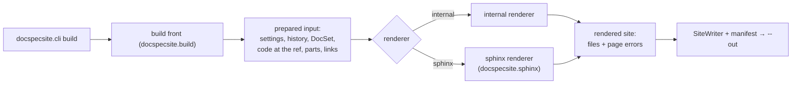

# How the site is built — the build front and its site renderers

`docspecsite build` has one **build front** that reads the settings, loads the history, the docs, the code at the ref and the parts, and writes the result to `--out`; between those steps a **site renderer** turns the prepared input into the site's files ([DSS-0008](decisions/DSS-0008-sphinx-site-renderer.md)).
There are two site renderers: `sphinx`, the default, which drives Sphinx in-process with MyST-Parser, sphinx-autoapi, the furo theme and docspecsite's own Sphinx extension, and `internal`, the custom renderer of [DSS-0001](decisions/DSS-0001-custom-per-doc-history-renderer.md), kept only for the migration.
What the site shows is in [behavior/site.md](../behavior/site.md); the parts every renderer shares (history model, link resolution, statuses, parts, the Docker image) and the `internal` renderer itself are in [docs-tooling.md](docs-tooling.md).

## Responsibilities and boundaries

- The build front owns everything a renderer must not decide twice: the backend and the ref, the loaded docs (`DocSet`) and history, the code at the ref, the parts, the version-aware link targets and markers, `--strict`, the output directory and the summary line.
- A site renderer only places that input on pages: it decides the page layout, the HTML and the output paths of its own generated pages.
- The `internal` renderer is temporary: a later release removes it with the `renderer` setting and the `--renderer` option, and neither the seam's interface nor the build front changes then.
- Renderers from outside docspecsite are out of scope: there is no registration.

## Design

### Build front



The front is `SiteBuilder` in `docspecsite.build`.
It reads the settings, picks the versioning backend, resolves the ref, loads the docs, the history, the code at the ref (with the symlink rules and the "cannot load code" and package-name warnings of docspecsite's code layer) and the parts, follows the symlinks under `docs/` and in the code directories, leaves out doc versions that are not valid UTF-8, gathers the non-Markdown files under `docs/` to copy, and passes all of it to the renderer as one prepared input.
It keeps an error local to its page (`attempt`), and with `--strict` turns every build warning into an error (`make_warnings_fatal`), for both renderers.
The renderer returns the site's files, or a directory holding them, and the per-page errors.
The front writes them to `--out` through `SiteWriter` and `.docspecsite-manifest`, so leftovers of an earlier build (also of the other renderer) are removed, a `--strict` build with an error writes nothing, and a build that stops in the middle leaves `--out` as it was.
It prints the summary line from the counts the renderer returns.

### The renderer seam

The seam is a small module, `docspecsite.renderers`:

- `RendererName`, the closed choice `internal` / `sphinx`, read from the `renderer` key of the `[site]` section by `ProjectConfig` and from `build --renderer` by `docspecsite.cli`: the option wins, then the setting, then the default `sphinx` ([behavior/configuration.md](../behavior/configuration.md#site)).
  Any other value of the setting is a wrong value, with the message `"renderer" must be "sphinx" or "internal"`: a problem in `check`, a stop in `list` and `build`; any other value of the option is a command-line error.
  An unknown key in `[site]` and a `site` that is not a table get the messages of [behavior/configuration.md](../behavior/configuration.md#site).
- `SiteRenderer`, the interface: one call that takes the prepared input and returns a `RenderedSite`: the files, the page errors and the page counts.
- the two implementations, picked by name from a fixed mapping; no entry points.

The interface carries nothing only the `internal` renderer uses: its build cache stays inside it, and a `RenderedSite` gives its page counts as an ordered list of labelled counts that the front prints as they come, plus the failed pages.
Each renderer gives the counts it has: the `internal` renderer `rendered` and `from cache`; the `sphinx` renderer `rendered` and `from cache` as `0`, since it keeps no pages between builds ([behavior/commands/build.md](../behavior/commands/build.md#what-the-build-does)).
The `sphinx` renderer counts the doc, version, diff, index and code pages, never search, the general index or Sphinx's own files; its failed pages are those left out by a page-local error ([Errors and warnings](#errors-and-warnings)).

**What the renderers share.** The renderers never import each other.
What both need is decided once, in modules of the front or of the doc model, and a renderer only places the result:

- the diff text of a diff page (the unified diff of two versions); each renderer marks it up its own way;
- which pages are versionless (the code reference's entry page);
- the target and marker of each link in each version (`Resolver` and `PageLinks` in `docspecsite.urls`): a renderer-neutral target, either a doc path with its version and anchor or a code object id, plus the marker; each renderer maps the target to its own URL;
- the index entries and their grouping (tags, components, milestones, priorities, the status board) and the `llms.txt` text: `docspecsite.indexes` is split into this model part, which both renderers use, and the `internal` renderer's HTML part;
- the reserved paths of both renderers, in one list in `docspecsite.urls` (`find_reserved_owner`), which `check` and the build front use;
- which non-Markdown files under `docs/` are copied, and how symlinks there are followed ([docs-tooling.md](docs-tooling.md#output-layout));
- the parts and which links cross them ([docs-tooling.md](docs-tooling.md#parts));
- the build result and its counts.

Only the `sphinx` renderer and its extension import Sphinx, MyST-Parser, sphinx-autoapi, astroid and furo; the front, the seam and the modules that `check`, `list` and `backlinks` use never do, so those commands do not load them.

### The `internal` renderer

`InternalRenderer` (`docspecsite.internal`) takes the page making out of today's `SiteBuilder`: the doc, version and diff pages, the code pages and the index pages, with markdown-it-py and Jinja, and the body cache in `.docspecsite-cache/`.
It maps a link target to today's `.html` hrefs and flat code page URLs, and marks up the diff text as its own diff HTML.
Its design is in [docs-tooling.md](docs-tooling.md) (Output layout, Page anatomy, Code reference, Incremental builds).

### The `sphinx` renderer

**Driven in-process.** The renderer runs `sphinx.application.Sphinx` with `confdir=None` and the whole configuration given as overrides built in code, including `linkcode_resolve` and autoapi's template directory; there is no `conf.py` in the checked repo, and nothing about Sphinx is a setting.

**Sphinx build directory.** `.docspecsite-cache/sphinx/` in the checked repo holds the generated source tree, the doctrees, Sphinx's environment and the staged output.
It is emptied at the start of every build, so every build is a full build ([DSR-24](../behavior/site.md#building)): Sphinx's own incremental build does not see changes to docspecsite's extension, and does not rewrite a doc when a doc it links to changes its headings.
The `internal` renderer's cache roots next to it are left alone.
Two builds of one repo at the same time are not supported.

**Source tree.** The renderer writes the latest docs at their paths and, with a versioned backend, every version at `<path>/v/<short-id>.md`, with `orphan` and `no-search` added to its front matter.
Each link is rewritten in the Markdown to the target and marker `PageLinks` gives it: the contemporary version, the latest version with "newer doc", "not found", "current code", or "→ moved" for a link to a redirect doc.
A doc target becomes a relative link to the target version's `.md` source in the tree, with its anchor, so MyST checks every rewritten link and anchor against the target version's own headings.
A code object target becomes a cross-reference that Sphinx's Python domain resolves against autoapi's objects.
Rewriting changes no line breaks, so a line in the source tree is the same line in the doc.
The code files of the built revision, which the front has read, are written into the Sphinx build directory for sphinx-autoapi.

**Parts.** With `--parts code`, the source tree holds only the code reference's entry page, as the site's root, and the code pages.
With `--parts docs`, sphinx-autoapi is not run, and `code:` links are text, as for a docs-only build of the `internal` renderer ([behavior/commands/build.md](../behavior/commands/build.md#what-the-build-does)).

**MyST.** Plain CommonMark plus the plugins docspecsite uses (front matter, tables, heading anchors): MyST's own extra syntax (`%` comments, `+++` breaks, `(label)=` targets, `` {role}`…` `` roles, footnotes) is switched off with `myst_disable_syntax`, and heading anchors use mdit-py-plugins' own `slugify`, given by its import path, as `check` does.
A `MystParser` subclass makes a fence such as ```` ```{x} ```` a code block like any other fence.

**Extension, `docspecsite.sphinx`.** A package split by concern:

- front matter: each page's front matter comes from the prepared input by docname, never by parsing the generated files again; MyST's own read is used only for `orphan` and `no-search`;
- page chrome on furo's template blocks: status badges, components, tags (styled as in the `internal` renderer), breadcrumb, redirect notice, old-version banner, the `[OLD]` title, the version picker as a collapsible list, and the Related and Linked-from panels;
- navigation: for each directory's `index.md`, the extension inserts hidden toctree nodes for its children itself, not as a directive fence, so every fence in a doc stays code;
- generated pages through `html-collect-pages`: tag and component index pages and the status board, from the shared index entries, and the diff pages;
- a diff page shows the shared diff text as a `diff` code block, highlighted by Pygments, Sphinx's own highlighter;
- `llms.txt`, the shared text, written at the end of the build;
- Mermaid: a `mermaid` fence becomes a diagram, and the vendored bundle is copied and loaded on pages with a diagram;
- links to non-doc files are resolved in a post-transform that runs before MyST resolves its own links; `code:` links are cross-references of the Python domain (Source tree, above).

**Theme.** furo, with Sphinx's "Powered by", `_sources/` and the copy-source link switched off.
The page chrome is built on furo's template blocks, so the theme is fixed.

**Code reference.** sphinx-autoapi reads the code from the Sphinx build directory with astroid, without importing it, in autoapi's nested page layout.
A class template override renders `__init__` as its own member and groups inherited members, which are listed.
An own docstring listener calls napoleon's public `GoogleDocstring` for Google-style sections and skips attributes, data and properties.
Source links come from `sphinx.ext.linkcode`, with the file and lines from autoapi's own parse, at the built revision through the backend's `file-link` pattern; there is no third read of the code.
`Docs:` lines and the "described in" lists come from docspecsite's model.
Roles in docstrings are resolved by Sphinx's Python domain.
Other packages' names in signatures and docstrings, PEP 695 type parameters and private names stay plain text without a warning; a target in the project's own packages that is not found gets the "no longer exists" marker and a warning.
The pages are autoapi's default: no collapsible member sections and no per-page member index.

**Search.** Sphinx's search covers the latest doc pages and the code reference pages.
An HTML builder subclass keeps version pages, diff pages and the generated index pages out of the search index, also out of its titles and file names, which `no-search` alone leaves in.

### Output layout of the `sphinx` renderer

```
site/
  index.html, <path>.html, <path>/v/<short-id>.html, <path>/v/<short-id>.diff.html,
  tags/<tag>.html, components/<c>.html, status.html, llms.txt      as for the internal renderer
  reference/code/<dotted path with "/" for ".">/index.html             code pages, packages and modules alike
  search.html  genindex.html  searchindex.js                         search and the general index
  _static/                                                           furo's and docspecsite's CSS and JS, the Mermaid bundle
```

The reserved doc paths of [docs-tooling.md](docs-tooling.md#output-layout) grow by the docs whose page would take one of these URLs: `search.md`, `genindex.md`, every doc under `_static/`, and every doc under `reference/code/` other than `index.md` (already reserved).
`check` reports the reserved paths of both renderers, whatever the `renderer` setting, so switching renderers never turns a passing check into a failing build.

Nothing else of Sphinx's output reaches `--out`:

- the Python module index is switched off, so there is no `py-modindex.html`;
- `objects.inv` and `.buildinfo` stay in the staged output and are not copied, so they need no reserved path;
- autoapi's own root index page is not part of the site: the hand-written `docs/reference/code/index.md` is the code reference's entry page and lists the packages' pages.

### Errors and warnings

- What docspecsite finds before Sphinx runs stays local to its page, as with the `internal` renderer: a version that is not valid UTF-8 or a doc at a reserved path is `error: <page>: <message>`, and the page is left out of the source tree.
- Sphinx's, MyST's and docutils' warnings are turned into docspecsite build warnings (`DocspecsiteWarning`), so `--strict` and `PYTHONWARNINGS` treat them like every other build warning ([docs-tooling.md](docs-tooling.md#errors-and-warnings)).
  Sphinx's source location is mapped back to the doc: a warning on the latest version of a doc prints as `warning: docs/<path>:<line>: <message>`, and one with no doc location as `warning: <message>` ([behavior/commands/build.md](../behavior/commands/build.md#what-the-build-does)).
  Warnings from version and diff sources are dropped, as the `internal` renderer warns about an unresolvable link only for the latest version of the linking doc.
- An exception inside Sphinx fails the whole build: one error line, exit code 1, and `--out` left as it was.

## Interfaces

- `docspecsite build --renderer internal|sphinx` and `[site] renderer` ([behavior/commands/build.md](../behavior/commands/build.md#what-the-build-does), [behavior/configuration.md](../behavior/configuration.md#site)).
- `SiteRenderer` in `docspecsite.renderers`: prepared input in, `RenderedSite` out.
- Sphinx's public extension points: events (`html-collect-pages`, `html-page-context`, `doctree-resolved`, `build-finished`), post-transforms, autoapi's template directory, napoleon's public classes, a `MystParser` subclass and an HTML builder subclass ([DSS-0008](decisions/DSS-0008-sphinx-site-renderer.md#consequences) lists each with its fallback).

## Operational notes

- **Pins.** Sphinx, MyST-Parser, sphinx-autoapi, astroid and furo are pinned in `uv.lock` like every dependency ([docs-tooling.md](docs-tooling.md#dependencies)); each extension point has a test that fails when the upstream code it relies on changes.
- **Two code readers.** `check --optional-checks code` and the `internal` renderer look roles up with docspecsite's own lookup over griffe, which follows Sphinx's Python domain rules ([docs-tooling.md](docs-tooling.md#code-reference)); the `sphinx` renderer's code reference is read by autoapi and resolved by Sphinx's Python domain itself.
  A test builds docspecsite's own code reference with the `sphinx` renderer and fails on a role that resolves in one but not the other, or to different objects.
- **Renderer comparison.** `scripts/compare_renderers.py`, run as `uv run python scripts/compare_renderers.py <repo path>`, builds both sites from the same repo state and compares them: the same pages per kind (latest, version, diff, index; code pages matched by object id); per latest and version page the same status badges, components, tags, breadcrumb, markers and links in the Related and Linked-from panels; every heading id of the `internal` page on the `sphinx` page; per diff page the same diff lines, not their markup; the same `llms.txt`; no dangling link; no version page in the search index.
  Only the differences listed in [DSS-0008](decisions/DSS-0008-sphinx-site-renderer.md#consequences) may remain.
  Its checks also run as tests on docspecsite's own docs.
- **Tests.** Tests of the `internal` renderer's own output (flat code URLs, slug anchors, the cache, from-cache counts) run against it only and go with it; tests of behavior both share (exit codes, warnings, `--parts`, `--strict`, error lines) run against both.

## Decisions

- [DSS-0008 — Sphinx as the site renderer, behind a renderer seam](decisions/DSS-0008-sphinx-site-renderer.md)
- [DSS-0001 — Custom static renderer with per-doc git history](decisions/DSS-0001-custom-per-doc-history-renderer.md) (superseded; the `internal` renderer)

## See also

- [docs-tooling.md](docs-tooling.md) — the parts both renderers share, and the `internal` renderer.
- [behavior/site.md](../behavior/site.md) — what the site shows, and how the two renderers differ for readers.
