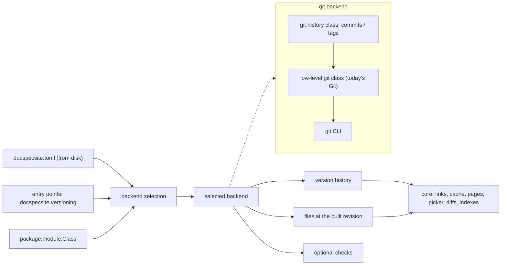

# Versioning backends

docspecsite's core (checks, link resolution, cache, pages, version picker, diffs, indexes) works on a finished **version history** that a **versioning backend** returns; it never runs a version control program itself.
A backend is a class behind one history-level contract ([DSS-0006](decisions/DSS-0006-history-level-backend-contract.md), an [architecture decision record](../meta/glossary.md#adr)), found by name through the Python entry-point group `docspecsite.versioning` or loaded from a `package.module:Class` path ([DSS-0005](decisions/DSS-0005-entry-points-for-backends.md)).
docspecsite ships two: `git`, which reads history with the `git` command line ([DSS-0007](decisions/DSS-0007-git-command-line.md)) and is itself built from a history-level class on top of a low-level git class, and `none`, which reads everything from disk and gives each doc one version.
The behavior is in [behavior/versioning-backends.md](../behavior/versioning-backends.md) (DSR-38, DSR-40 to DSR-43).

## Responsibilities and boundaries

| Core | Backend |
| -- | -- |
| Reading `docspecsite.toml` from disk ([docs-tooling.md](docs-tooling.md#configuration)), the top-level `[versioning]` table and the choice of backend | Validating its own `[versioning.<name>]` table |
| Version-aware link resolution ([DSR-11](../behavior/site.md#rendering)), from each version's position | Which revisions are versions, their ids, labels, messages, positions and content keys |
| The cache, pages, picker, diffs, indexes, `llms.txt`, the code reference | The doc texts and the files at the built revision (code directories, assets under `docs/`) |
| The `check` rules, and `--optional-checks` parsing over core and backend checks | Its optional checks, and their problems |
| Filling link patterns with `{source-url}` and `{path}` | Default link patterns, and the `{revision}` value |

Nothing outside the backends knows about commits, blobs, first-parent history or the staging area: those are the git backend's terms ([anti-goal](#rejected-designs)).
Core stays free of `if backend == "none"` branches: what differs between backends is asked from the backend's capabilities ([Contract](#contract)).

## Design

### Start of every command

1. Read `docspecsite.toml` from disk (unchanged, by `ProjectConfig`); the `[versioning]` table's `backend` key is parsed with the other top-level keys by `ProjectConfigParser`.
2. Select the backend ([Finding a backend](#finding-a-backend)) and let it parse its own table, with the existing parser's messages, so its problems join the other settings problems: `check` reports them, `list` and `build` stop on a wrong value and warn about an unknown key ([DSR-32](../behavior/configuration.md#requirements)).
3. Validate the options that depend on the backend: the names in `--optional-checks`, `--ref` (rejected when the backend takes no revision) and `--include-worktree` (ignored when the backend has no working-copy version).
   An invalid one is a command-line error, exit code 2, through the argument parser's usage error, as for `--parts`.
   Since the available checks are known only after step 2, `--optional-checks` is read as text by the argument parser and turned into checks here.
4. Run the command with the selected backend.

`build` prints `versioning: <name>` (with ` (auto)` when auto-detection picked it) before the first page.

### Finding a backend

- **Registered names** come from `importlib.metadata.entry_points(group="docspecsite.versioning")`: each entry maps a name to a backend class.
  docspecsite registers its own `git` and `none` the same way, in `[project.entry-points."docspecsite.versioning"]` of its `pyproject.toml`, so built-in and third-party backends are found by one mechanism.
- **An import path** `package.module:Class` is resolved with `pkgutil.resolve_name`, the standard library's resolver for this `module:attribute` form (the form entry points use), without registering anything.
- **`auto`** asks each registered backend class whether it can handle the checked repo, through a class-level detection method that needs no settings: git, when the `git` program is found and the directory is the top level of a git work tree; a Mercurial plugin, when `.hg/` exists.
  Exactly one → that backend; none → `none`; several → an error naming them, which stops every command (exit code 1).
  A built-in backend whose [Python optional dependencies](glossary.md) are not installed (its imports fail) is left out of `auto`; when named explicitly, the missing dependencies are its error.
  To keep today's behavior for a subdirectory of a git repo, git's detection tells "inside a git work tree, not at its top level" apart from "no git repo": the former stops every command with today's error, also under `auto` ([behavior/commands/](../behavior/commands/index.md#running-a-command)).
- **An explicit name or path is strict:** the selected backend's own check that it can handle the repo failing is an error that stops every command; nothing falls back.
- **An unknown name or a path that cannot be loaded** is a settings problem on `backend`: `check` reports it and goes on with `auto`; `list`, `build` and `backlinks` stop with an error naming the setting.
- Each backend class has a fixed **name**, the one it is registered under by its package; its settings table is `[versioning.<name>]` and its checks are `<name>:<check>`, also when it is loaded by import path.
  The table of another backend is not read, so it raises no warning.

### Contract

What every backend provides; the code names are the builder's, and the code reference shows them once built.
Whether it is a protocol or an abstract base class is the builder's call too.

| Part | Meaning |
| -- | -- |
| name | The backend's name: its settings table and its checks' namespace. |
| detection | Class-level: whether it can handle a directory (for `auto`), without settings. |
| settings | Parses its `[versioning.<name>]` table into its own settings object, returning problems the way `ProjectConfigParser` does. |
| capabilities | Whether it has history (versioned pages, picker, diffs, banners), whether it accepts a revision (`--ref`) and which one it builds without `--ref` ([build.md](../behavior/commands/build.md#what-the-build-does)), whether it has a working-copy version (`--include-worktree`). |
| history | For the built revision (and, when asked, the working tree): each doc's versions, newest first; the doc texts; the set of doc paths at the built revision. A backend never returns a symlink as a doc: a path that is a symlink in a version has no such version, a path that is a symlink at the built revision has no committed versions at all, and a `.md` file reached through a symlinked directory is no doc ([DSR-39](../behavior/doc-symlinks.md#on-the-site)). When the working tree is read, a path that is a symlink at the built revision but a regular doc in the working tree is a new uncommitted doc with the working-copy version as its only version, and a path that is a regular doc at the built revision but a symlink in the working tree has no working-copy version and keeps its committed versions. |
| files | The code directories at the built revision, extracted for griffe, and, when the working tree is read, which code files differ from the built revision. The non-Markdown files under `docs/` (assets). A symlink there counts by what it leads to, whatever its name, by the one rule for following a symlink ([docs-tooling.md](docs-tooling.md#history-model)): one that leads to another file is given as that file, read where the other files are read (when the working tree is read, among the files the backend sees there), never as its link text, and one that leads to a directory as the non-Markdown files inside it, at their paths below the symlink, with the symlinks inside followed by the same rule. A symlink that leads to a doc is left out. A symlink that leads out of the repo or to nothing is left out and named, so that the build can give the warning for it ([DSR-39](../behavior/doc-symlinks.md#other-files-under-docs)). |
| repo file paths | The paths of the repo files a link can lead to, which core's link resolution takes as found ([build.md](../behavior/commands/build.md#what-the-build-does)): the files at the built revision and, when the working tree is read, the non-Markdown files under `docs/` there. The assets given through a symlink are among them under the paths they are given at; the path of a symlink that leads to a doc is not, nor is that of a symlink left out of the files. |
| link patterns | Default `file-link` and `dir-link` patterns and the `{revision}` value of the built revision. |
| optional checks | Its checks by name; each runs on the checked repo and returns problems in `check`'s form. |

Each **version** carries: an id (full revision id; for git the commit SHA), a short id (used in `/v/<short-id>.html` URLs and labels), a date, a message (shown in the picker, its `spec:`/`docs:` prefix stripped by core as today), an optional label (git tags mode: the tag name), a position in one linear order (0 for the built revision, higher for older ones; core resolves [DSR-11](../behavior/site.md#rendering) links with it, as `History` does today with each commit's position), and a content key (today's blob SHA; any stable hash of the text) that names cache entries.
The working-copy version keeps today's form (short id `worktree`, position -1).

Today's `docspecsite.history.History` and `Version` become the core side of this: `Version` loses its git `Commit` in favour of the fields above, and the git calls with which `History` loads the versions move into the git backend.

### Optional checks

Core's optional checks keep their plain names (`code`); a backend's are offered under `<name>:<check>`.
The available set is one decision, made in one place: core's checks plus the selected backend's.
`Choice` keeps the parser of comma-separated names; for the dynamic part, the parser takes the available names instead of only a `Choice` subclass's members, so its "no … given" and "available: …" messages stay the same.
How a backend hands its checks to core (a mapping from name to a callable, or check objects) is the builder's call.

The git backend's `staged` check is today's `Checker` staged-changes rule (on the staged changes `Git` lists, [DSR-6](../behavior/versioning-backends.md#versions-of-a-doc)); `check --staged` is removed without an alias, and the prek hook's entry becomes `docspecsite check --optional-checks git:staged` in the same release.
That is an incompatible change of the public interface ([versioning.md](versioning.md#public-interface)).

### git backend

Two documented, public extension points:

- **The low-level git class** — today's `docspecsite.git.Git`: `resolve`, `list_first_parent`, `list_changes`, `read_tree`, `read_blobs`, `hash_files`, `list_worktree_files`, `list_staged_changes`, `extract`, plus listing tags (`git for-each-ref refs/tags`, with each tag's peeled commit).
  It runs `git` as today ([docs-tooling.md](docs-tooling.md#history-model)).
- **The git history class** — the history-level backend: it reads `[versioning.git]`, selects versions and implements the contract by calling the low-level class (template method: version selection here, primitives there).

A plugin can replace only the low-level class (another git library, or a system that stores its data in git) by subclassing the history class with another low-level class, or subclass the history class to change version selection.
Both classes are public API: their method signatures follow the release rules ([versioning.md](versioning.md#public-interface)).

**`versions = "commits"`** is today's history model, unchanged.

**`versions = "tags"`** ([DSR-38](../behavior/versioning-backends.md#versions-from-tags-only)):

1. List the tags matching `tag-pattern` (`fnmatch` on the tag name, as `git tag --list` matches) whose peeled commit is on the built revision's first-parent list; order them by that position.
2. For each doc and each tag, its version is the doc's newest commit at or before the tag's position (from the same per-path change list as commits mode).
   Consecutive tags with the same version give one version, labelled with the first (oldest) of those tags.
3. The version's position is that tag's position, so [DSR-11](../behavior/site.md#rendering) resolution in a version at tag `v2` finds the target's version at `v2`; its id and short id stay the commit's, so URLs equal those of commits mode.
4. Whether commits after the newest tag are versions stays open ([behavior](../behavior/versioning-backends.md#not-decided-yet)).

**Default revision:** without `--ref` the git backend builds `HEAD`, the checked-out commit, whether or not the working tree is read (`--include-worktree`) ([build.md](../behavior/commands/build.md#what-the-build-does)).

**Symlinks:** the git backend tells a symlink by its tree entry's mode in a revision, and by the file itself in the working tree.
It reads a symlink's target where it reads the other files: in the tree of the built revision, or among the working-tree files git sees (tracked, or untracked and not ignored), which gives the rules of the history and files rows of the [contract](#contract).

**Link patterns:** defaults `{source-url}/blob/{revision}/{path}` and `{source-url}/tree/{revision}/{path}`, with `{revision}` the built commit's full SHA; they replace the hard-coded `blob/` and `tree/` URLs of `docspecsite.urls`, `docspecsite.coderef` and `docspecsite.build`.

### none backend

- Capabilities: no history, no revision, no working-copy version.
- History: one version per doc, read from disk under `docs/`, with short id and position fixed, no message; a symlink under `docs/`, and a `.md` file reached through one, is left out; core renders a versionless doc as it renders the code reference's entry page today: the latest page only, no `/v/` pages, picker, diffs or banner.
- Content key: a hash of the file's bytes (the hash is the builder's choice), so the cache works as for git.
- Files: the `code-dirs` directories and the non-Markdown files under `docs/` from disk (as `--include-worktree` reads them today), leaving out names starting with `.`; a symlink there is followed on disk as the files row of the [contract](#contract) says.
- Repo file paths: the files on disk under the checked repo, without the paths the contract excludes: a symlink that leads to a doc, a `.md` file inside a symlinked directory under `docs/`, and a symlink left out of the files.
- Link patterns: none by default; `[versioning.none]` may set patterns, and one with `{revision}` is a settings problem.
- No optional checks, so the delete/rename rule is not checked.

## Interfaces

- Settings: [behavior/configuration.md](../behavior/configuration.md#versioning).
- Commands: `--ref`, `--include-worktree` and `--optional-checks` per backend ([behavior/commands/](../behavior/commands/index.md)).
- Entry-point group `docspecsite.versioning`: name → backend class; a third-party package declares it in `[project.entry-points."docspecsite.versioning"]` of its `pyproject.toml`.

## Operational notes

- A built-in backend with Python dependencies ships them as Python optional dependencies, `docspecsite[<name>]`; git has none, since it only needs the `git` program, which the Docker image already installs.
- A third-party backend is installed next to docspecsite: in the prek hook's `additional_dependencies`, or in a project image built `FROM` docspecsite's image with the package added (the guide is [guides/using-docspecsite.md](../guides/using-docspecsite.md)).
- The `internal` renderer's cache has one root per docspecsite version, set of built parts and backend name, so content keys of different backends never meet ([docs-tooling.md](docs-tooling.md#incremental-builds)).

## Rejected designs

- **A low-level contract** (resolve, linear revisions, per-path changes, contents, staging, export) with history and version selection in core: smaller backends, but git-shaped, `none` would fake revisions, and tags would become a core feature ([DSS-0006](decisions/DSS-0006-history-level-backend-contract.md)).
- **Reading settings through the version control**: settings stay a light, file-only step read before any backend exists ([docs-tooling.md](docs-tooling.md#configuration)).
- **Backend command options** (such as keeping `--staged`): options would change with the selected backend; settings tables and namespaced optional checks cover the same needs.

## Decisions

- [DSS-0005 — Entry points for versioning backends](decisions/DSS-0005-entry-points-for-backends.md)
- [DSS-0006 — History-level backend contract with a layered git backend](decisions/DSS-0006-history-level-backend-contract.md)
- [DSS-0007 — git through its command line, not a git library](decisions/DSS-0007-git-command-line.md)

## See also

- [docs-tooling.md](docs-tooling.md) — the rest of docspecsite, which uses the history this doc describes.
- [meta/versioning.md](../meta/versioning.md) — the method's rules every backend follows.
