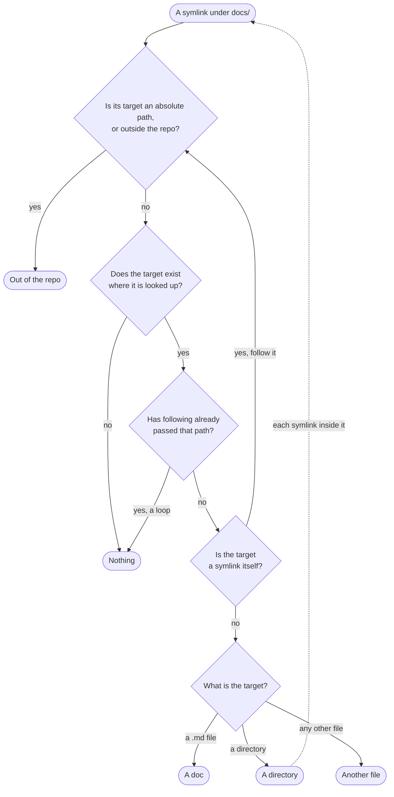

# Symlinked docs

A [symlink](glossary.md) is a file that only points to another file or directory, and it can make one doc appear at two paths.
But every version of that doc would then show the link instead of the text, and its history would be the history of the link, not of the text.
So no doc is reached through a symlink under `docs/`.
What a symlink is depends only on what it leads to, never on its own name: the check reports one that leads to a doc, to a directory with a doc inside, out of the repo or to nothing, and says how to replace it, and listings and the site leave such docs out.
A symlink that leads to another file, such as an image, or to a directory without docs is allowed, and the site gets the files it leads to.

This is a limit of docspecsite, not a rule of the docs method ([meta/](../meta/index.md)), which says nothing about symlinks.
The limit comes from how the tool reads and renders docs, like the reserved paths (the doc paths docspecsite keeps for its generated pages) and the UTF-8 rule (every doc is readable UTF-8 text) ([DSR-20](commands/check.md#requirements)).

## Requirements

> **Changed, not built yet.** The `git:staged` check is still the `--staged` option.

This requirement is part of the [DSR-n](../meta/glossary.md#dsr-n) numbering listed in [requirements.md](requirements.md):

- **DSR-39** A symlink under `docs/` is judged by what it leads to in the end, never by its own name ([How a symlink is followed](#how-a-symlink-is-followed)).
  What it leads to gives its kind, and the check, the listings and the site treat it by its kind alone ([The kinds of symlink](#the-kinds-of-symlink)).
  It is a check problem ([DSR-20](commands/check.md#requirements)) when it leads out of the repo, to nothing, to a doc (a `.md` file) or to a directory with a doc inside.
  The hint depends on where the symlink leads ([What the check reports](#what-the-check-reports)).
  A symlink that leads to another file, such as an image, or to a directory with no doc inside is allowed: the check does not report it, and it reaches the site as what it leads to ([Other files under docs/](#other-files-under-docs)).
  A symlink is never a doc, and nothing reached through one is: `list` and `backlinks` leave them out, the site has no pages for them, and a link to one is a broken link ([Listings and links](#listings-and-links), [On the site](#on-the-site)).
  Doc templates are not docs, and no check looks at them, so a symlink inside `docs/meta/templates/` is not reported.
  A symlink needs no `index.md` and no entry in one ([DSR-20](commands/check.md#requirements)).
  A symlink may be removed or renamed: the rule that files under `docs/` are never deleted or renamed ([DSR-6](versioning-backends.md#versions-of-a-doc)) is for docs, and a symlink never was one, so the `git:staged` check passes over a path that was a symlink in the last commit.
  The exact problem lines and hints are in [check.md](commands/check.md#what-the-check-reports).

## How a symlink is followed

The check and the build both work out what a symlink leads to, which gives the symlink's kind ([The kinds of symlink](#the-kinds-of-symlink)): the check to decide whether it is a problem and which hint it gets ([What the check reports](#what-the-check-reports)), the build to find what it puts on the site ([Other files under docs/](#other-files-under-docs)).
Both do it by the same rule, which never looks at the symlink's own name:

- **A chain of symlinks is followed inside the repo.**
  When the target is itself a symlink, that one is followed too, and so on along the chain, as long as every step stays inside the repo.
  The symlink leads to what stands at the end of the chain: a doc (a file whose name ends in `.md`, inside `docs/` or outside it), a directory, or another file.
- **Nothing is followed out of the repo.**
  Following stops when a target is an absolute path (one that starts at the root of the file system, such as `/srv/notes/setup.md`) or lies outside the repo, at any step of the chain.
  Neither the check nor the build looks at what is there: the symlink leads out of the repo, whatever it points to.
- **A missing target and a loop lead to nothing.**
  A chain can end at a path that does not exist.
  It can also come back to a path that following has already passed on its way from `docs/`: a directory the symlink lies in, a symlink already followed, or a place one of them led to.
  Such a loop ends there, and the symlink leads to nothing in both cases.
- **A directory is looked into by the same rule.**
  When a symlink leads to a directory, each symlink inside it, or in a directory below it, is followed in the same way.
  Such a symlink has its path below the first one: `docs/img/logo.png` is the symlink `logo.png` in the directory that `docs/img` leads to.
  A directory has a doc inside when a `.md` file lies in it or in a directory below it, or when a symlink there leads to a doc or to a directory with a doc inside.
- **The target is looked up where the command reads its other files.**
  The check looks in the working tree it checks (the files as they are now on disk).
  The build looks in the built [revision](glossary.md) (a saved state of the project, such as a commit), or in the working tree for a preview with `--include-worktree` ([build.md](commands/build.md#what-the-build-does)).
  In the working tree the build reads only the files that git sees (tracked files, and untracked files that git does not ignore), as for the other files it reads there, so a target that git ignores counts as one that does not exist.

The diagram shows the same rule:

## The kinds of symlink

What a symlink leads to in the end is its kind ([How a symlink is followed](#how-a-symlink-is-followed)).
The check, the listings (`list` and `backlinks`) and the site each treat a symlink by its kind alone, whatever its name:

| The symlink leads | The check | The listings | The site |
| -- | -- | -- | -- |
| out of the repo | reports a problem | it is not a doc | leaves it out, with a warning |
| to nothing | reports a problem | it is not a doc | leaves it out, with a warning |
| to a doc | reports a problem | it is not a doc | leaves it out, without a word: it has no pages |
| to a directory with a doc inside | reports one problem, for the whole directory | nothing inside it is a doc | gets the files inside it that are not docs, and no pages |
| to a directory with no doc inside | allows it | nothing inside it is a doc | gets the files inside it |
| to another file, such as an image | allows it | it is not a doc | gets that file |

The sections below hold what is particular to one command: the check's hints and its other rules ([What the check reports](#what-the-check-reports)), links to a symlink ([Listings and links](#listings-and-links)), a path that is a symlink in some versions only ([On the site](#on-the-site)), and how the site gets the files a symlink leads to ([Other files under docs/](#other-files-under-docs)).

## What the check reports

The check reports a symlink of the first four [kinds](#the-kinds-of-symlink), and its hint depends on where the symlink leads:

| The symlink leads | Hint |
| -- | -- |
| out of the repo | none |
| to nothing | remove the symlink; its target does not exist |
| to a doc inside `docs/`, or to a directory inside `docs/` with a doc inside | link to that doc or directory in the text instead, and remove the symlink |
| to a doc outside `docs/`, or to a directory outside `docs/` with a doc inside | move that doc or directory to the symlink's place, and put the symlink at its old place instead |

A symlink that leads out of the repo is a problem whatever it points to: the check does not look outside the repo, and what lies there is not part of the repo's history.
The problem is reported on the symlink itself, and names the target in the form the symlink stores it (such as `../../vendor/shared.md`).
A hint names the doc or directory the symlink leads to.
In the hint to move a doc, the doc's new place is the symlink's path; when the symlink's own name does not end in `.md`, it is that path with `.md` added (`docs/guides/setup-copy.md` for the symlink `docs/guides/setup-copy`), so that the moved file is a doc.

A symlinked directory with a doc inside is one problem, on the directory's symlink: the check reports nothing for what is inside it.
Inside a symlinked directory that is allowed, the check reports a symlink that leads out of the repo or to nothing, at its path below the directory's symlink.
A symlink is not checked any further as a doc: the check looks at what it leads to only to decide the problem and its hint.
A symlink anywhere in `docs/meta/templates/`, `index.md` included, is not reported, whatever it leads to and whatever its name, since doc templates are skipped in every check.
No symlink under `docs/` is a directory that needs an `index.md` or a child that an `index.md` lists ([check.md](commands/check.md#what-the-check-reports)).

## Listings and links

A symlink of any [kind](#the-kinds-of-symlink) is not a doc, and neither is anything reached through one: `list` leaves them out, and `backlinks` says of such a path that it is not a doc ([backlinks.md](commands/backlinks.md#options-and-output)).
When another doc links to a symlink that leads to a doc or to a directory with a doc inside, or to a `.md` file inside a symlinked directory, the check reports a broken link whose message says why, such as `broken link: docs/guides/alias.md is a symlink, not a doc` ([check.md](commands/check.md#what-the-check-reports)), and the site shows a link whose target is not found ([build.md](commands/build.md#what-the-build-does)).
A link to a file that is not a doc inside a symlinked directory is not broken, also when the check reports the directory: the site copies that file ([Other files under docs/](#other-files-under-docs)).

## On the site

The build says nothing about a symlink that leads to a doc: it is neither an error nor a warning, since `check` reports it.
A path can be a symlink in some [revisions](glossary.md) (saved states of the project, such as commits) and a doc, a file with its own text, in others:

- a version in which the path is a symlink is left out;
- a path that is a symlink at the built revision is not a doc of the site: it has no pages in any version;
- a path that is a doc at the built revision keeps the versions in which it was one.

In a preview of the working tree (`--include-worktree`), the working tree counts too:

- a path that is a symlink at the built revision but a doc in the working tree is a new uncommitted doc: it gets a working-copy version, its only version;
- a path that is a doc at the built revision but a symlink in the working tree has no working-copy version, and its committed versions keep their pages.

## Other files under docs/

A file that is not a doc, such as an image, may also be used outside the docs: it then lives outside `docs/`, and a symlink next to the doc that shows it points to it.
The same goes for a whole directory of such files.

The site gets the file a symlink leads to, never the text of the link (the path the symlink stores).
The files inside a symlinked directory reach the site at their paths below the symlink, and so do the files that the symlinks inside it lead to.
A `.md` file inside a symlinked directory is not among them, and neither is a symlink there that leads to a doc: it is not a doc and gets no page, and the build says nothing about it, since `check` reports the directory.

How the build finds what a symlink leads to, and where it looks the target up, is in [How a symlink is followed](#how-a-symlink-is-followed).
It leaves a symlink out of the site when the symlink leads out of the repo or to nothing.
`check` reports such a symlink, so a repo that passes the check has none; when the build still meets one, it gives a warning that names the symlink: `docs/<path>: symlink to an absolute path, outside the repo or to a missing file; left out` ([build.md](commands/build.md#what-the-build-does)).
A link to it from a doc is then shown as a link whose target is not found ([build.md](commands/build.md#what-the-build-does)).

## Symlink loops

Symlinks can form a loop, such as `docs/shared` leading to a directory that holds a symlink back to `docs/`.
No loop makes `check` or the build run forever or report the same thing twice.
The rule for following gives this ([How a symlink is followed](#how-a-symlink-is-followed)): following never passes the same path twice on its way, so a symlink that leads back to a path already passed leads to nothing, and is reported and left out like one whose target does not exist.
And docs are never read through a symlink, so no doc is found twice through a loop.

## See also

- [scenarios/doc-symlinks.md](../scenarios/doc-symlinks.md) — exact cases for symlinks to docs, directories and images.
- [check.md](commands/check.md#requirements) — DSR-20, everything the check validates.
- [check.md](commands/check.md#what-the-check-reports) — the exact problem lines and hints.
