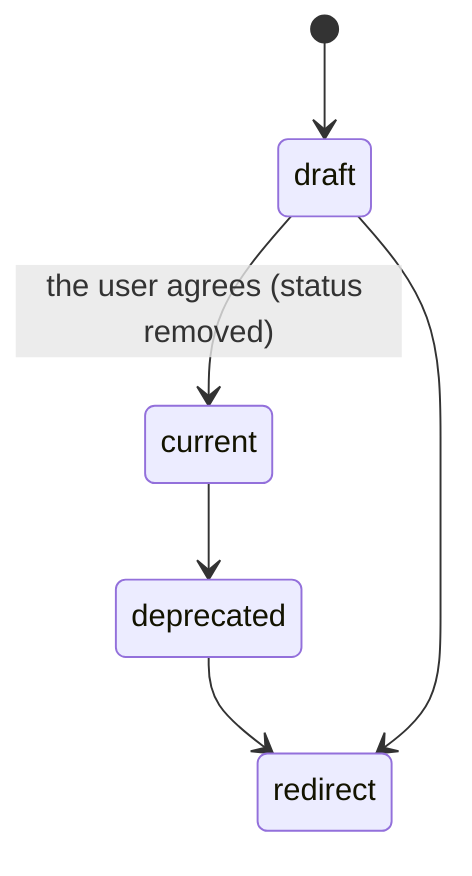

# Doc lifecycle and docs as a task list

## Specs, not tickets

Docs describe **the target state** of the system, written as if it were already true: "Checkout keeps the items in the order they were added to the cart", not "Make checkout keep item order" or "Bug: items are reordered".
There are no change requests or bug reports in `docs/`.

Work arises from the **gap between docs and code**.
To ask for a change, edit the spec to describe the desired state and set its `status` accordingly; the diff of that commit *is* the change request.
A bug is code that contradicts an `implemented` doc; for a scenario doc, a case that fails while the section its `Feature` links is `implemented` ([below](#scenario-docs)).

## Status values

| `status` | Meaning | Is it work? |
| -- | -- | -- |
| `draft` | Being written; not agreed. Do not build from it. | Spec work |
| `specified` | Agreed target state; not built yet. | **Yes — to do** |
| `changed` | Agreed target state that differs from what is built; the code still does an older form of it. | **Yes — to do** |
| `implemented` | The code (or practice) matches the doc. | No |
| `deprecated` | Still true, but scheduled to go away; says what replaces it. | Removal work |
| `redirect` | Renamed, moved, merged, split, replaced or removed; see `redirect_kind`, `redirect_to`, `reason`. | No |

Transitions: `draft → specified → implemented`; `implemented → changed → implemented`; any → `deprecated` → `redirect`.
When an `implemented` doc is edited to describe new behavior, it becomes `changed` until the code catches up.
When only some of its sections change, or a doc is built in parts, it lists several statuses and marks its sections ([below](#partly-built-docs)).
For docs that describe practices rather than code (meta, agents), `implemented` means "in effect".

A parent doc's status summarizes its children: if any child is `specified` or `changed`, the parent should not claim `implemented` for that part.

## Layers without a build status

`specified`, `changed` and `implemented` are the **build status** values: they say how far the code has caught up with a doc.
Docs in these layers have no build status:

- `scenarios`: their cases belong to rules that behavior and ui docs own, and those docs say whether the rules are built ([below](#scenario-docs)).

A doc in such a layer carries no build status in its `status`, no `milestone` or `priority` field, and no [status notes](#status-notes); [partly built docs](#partly-built-docs) do not apply to it.
The docs tooling ignores them where they appear: it reads the doc as if they were not there.
It may have `status: draft`, `deprecated` or `redirect`, also as a one-value list such as `status: [draft]`; these are about the doc itself, not about the code.
Without `status`, it is a current, agreed doc.

Transitions: `draft` → no `status` (the field is removed when the user agrees to the doc) → `deprecated` → `redirect`; `draft` → `redirect`.



Such a doc does not return to `draft`: when it is revised, the doc that owns the rules tracks the work ([below](#scenario-docs)).

The docs check gives one warning for a `status` that holds `implemented` in such a doc, since that value can mislead a reader once the doc that owns its rules changes and nobody updates it; the other ignored values and status notes give neither a problem nor a warning.
The status views of the docs tooling (`list --status`, the status board, the status badge of a page) leave such docs out, except those with `draft`, `deprecated` or `redirect`.

### Scenario docs

The behavior and ui docs a scenario doc gives cases for are in its `related` front-matter field, which may also name other docs, such as architecture docs or other scenario docs.
A scenario doc without `status` or with `status: draft` names at least one behavior or ui doc there that is neither `deprecated` nor `redirect`; this does not apply to an `index.md`, whose children carry the links.
Each `Feature`'s intro links the section of the behavior or ui doc that owns its rule ([authoring.md](authoring.md#style-per-layer)).
That section's status, the first value of its doc's `status` or its status note, says whether the `Feature`'s cases should already hold: a failing case is a bug when that section is `implemented`.

When cases are added to or changed in an agreed scenario doc, it stays without `status` and is edited in place.
When the owning section is `implemented`, it gets `> **Changed, not built yet.**` (or its doc becomes `changed`) until the code and the tests catch up, so the work shows among the `changed` docs; a `specified` or `changed` section keeps its status, since its cases already count as work.
A scenario doc is deprecated when every behavior and ui doc it gives cases for is deprecated; while only some of them are, it stays as it is, and the `Feature`s that link a deprecated doc are removed when that doc becomes a redirect.

The docs check reports a scenario doc that breaks the rule on its `related` list above, also when the list is missing or empty; it does not check the links in the `Feature` intros: which section owns a rule is the author's call, which a check cannot tell, so they are a writing rule ([authoring.md](authoring.md#style-per-layer)).

## Partly built docs

A doc can be partly built, unless it is in a [layer without a build status](#layers-without-a-build-status): some of its sections are true in the code, others are not yet.
Its `status` is then a list of distinct values from `implemented`, `specified` and `changed`, such as `status: [implemented, specified]`.
The doc's title is its level-1 heading, right after the front matter ([authoring.md](authoring.md#page-shape)).
The title and the [document brief](authoring.md#page-shape) under it carry no status note: the doc's whole `status` describes them, so the brief may mention built and unbuilt parts alike.
Every other heading, at any level, starts a section of its own: the heading and its text up to the next heading of any level, so a `##` section does not include the `###` sections below it.
The first value is the status of every section without a status note; each further value is the status note of at least one section.
`draft`, `deprecated` and `redirect` are never combined with other statuses; each may still be written as a one-value list, such as `status: [draft]`.

### Section notes

A section's notes are the Markdown note lines that come right after its heading, before any other content (a paragraph, list, table, code block or subheading).
Each kind of section note is recognized by the bold label at its start; a status note is one kind.
The order of the notes in that block does not matter.
A note line with a label that is not a known kind is ordinary text, so new kinds can be added later without breaking existing docs.

### Status notes

A status note is a section note that starts with one of these exact texts; they are the docs tooling's defaults, and a project may set its own, for example to write its docs in another language.

| Status note | The section is |
| -- | -- |
| `> **Not built yet.**` | `specified`: not built at all. |
| `> **Changed, not built yet.**` | `changed`: the code implements an older form of this section. |
| `> **Built.**` | `implemented`, in a doc whose first value is `specified` or `changed`. |

Text may follow on the same line, such as what still works the old way: `> **Changed, not built yet.** Exports still use the old file name.`
A status note is plain text: it reads as an ordinary note on GitHub, in editors and on the rendered site.
A section has at most one status note.
A status note gives the status of its own section only: the sections under deeper headings below it have the first value unless they have a status note of their own.
A status note right under the title belongs to no section; the doc's status is set in its `status` instead.

```markdown
---
status: [implemented, changed]
---

# Export

## Choosing the format

Exports are CSV or JSON.

## File name

> **Changed, not built yet.** Exports still use the old file name.

The file is named after the project and the date.
```

The docs check enforces the status notes:

- no value appears twice in the list;
- every value after the first is the status note of at least one section;
- no section has more than one status note;
- no status note sits right under the title;
- every status note's status is in the list;
- no status note gives the first value;
- a doc with a single status has no status notes.

When a section with a status note is built, its status note is removed, and a value whose last status note is gone leaves the list; a list with one value left may stay a list, and means the same as that single value.
The first value may change as the work goes on, such as from `[specified, implemented]` to `[implemented, specified]` once most sections are built: the doc's status notes are then redone, so every section whose state differs from the new first value gets its status note, and the status notes of the new first value are removed.
`check` reports a status note left with the new first value, but it cannot tell a section without one that should now carry one, so redoing the status notes goes section by section.

## ADRs

Architecture decision records ([ADRs](glossary.md#adr)) also carry `decision`:

| `decision` | Meaning |
| -- | -- |
| `proposed` | Suggested, not yet agreed. |
| `accepted` | Agreed. Its `status` then tracks whether it is built (`specified` / `implemented`). |
| `superseded` | Replaced; `superseded_by` points to the newer ADR. ADR text is not rewritten. |

The ADR index (`architecture/decisions/index.md`) lists each ADR as `- [<PREFIX>-NNNN](<PREFIX>-NNNN-<slug>.md) — <decision>, <status> — <title>`, so both are visible at a glance; it groups ADRs by prefix ([structure.md](structure.md#adr-ids)).

ADRs are the one place where history is part of the content: a superseded ADR keeps its original reasoning.
All other docs only ever describe the current target.

## Using status as a task list

- "What is left to do?" → all docs with `specified` or `changed` anywhere in their `status` (and `draft` for spec work); in a partly built doc, the sections its status notes and its first value name.
- "What is left for part X?" → the same, filtered by `components: [X]`.
- "What is next?" → `specified` docs of the earliest unfinished milestone (the project's `roadmap.md`), `must` first, then `should`, then `could`.
- A doc in a [layer without a build status](#layers-without-a-build-status) shows here only as `draft` spec work or `deprecated` removal work: the work of building its cases shows in the docs that own their rules.
- Tooling provides a status board and filtered listings ([docspecsite](https://github.com/imposeren/docspecsite/blob/main/docs/behavior/index.md)).
- `milestone` says *when* a target state is due, `priority` how important it is within that milestone ([front-matter.md](front-matter.md)); a milestone is reached when all its `must` docs have `status: implemented` alone, not as part of a list.
- Granularity comes for free from depth: a depth-1 doc is an epic, its depth-2 children are stories.
